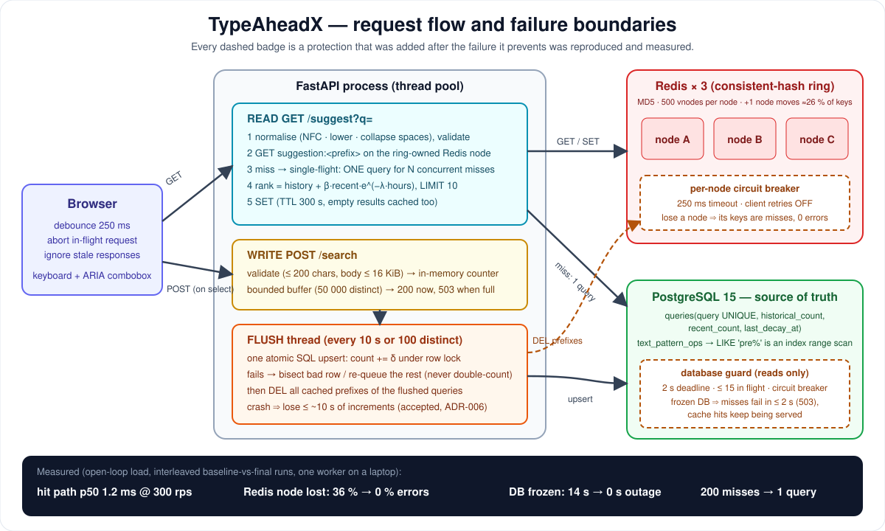
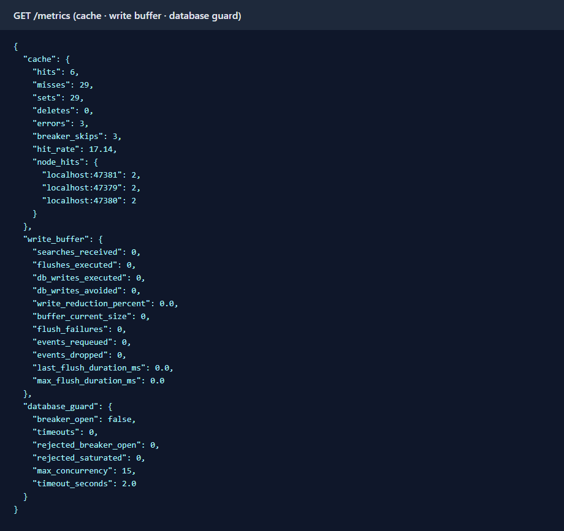
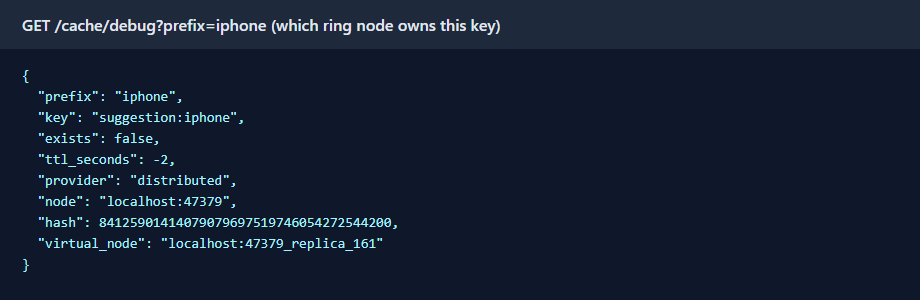

# TypeAheadX

**Search autocomplete as a system design study** — a sharded Redis cache in front of PostgreSQL, a write buffer for popularity updates, trending ranking with exponential decay — where every design decision was *measured*, the failure modes were deliberately *broken*, and the fixes and trade-offs are written down.


<sub>Real UI, real requests: a cache node is killed mid-session; suggestions keep arriving, the server-side time per request is shown, **0 HTTP errors**. (Captured by [`benchmarks/demo/capture_demo.py`](./benchmarks/demo/capture_demo.py).)</sub>

## 30-second summary

* **What:** `GET /suggest?q=iph` → top-10 suggestions from 150 000 real queries; selecting one feeds popularity and trending back in.
* **How:** consistent-hash ring over 3 Redis nodes (cache-aside) → PostgreSQL with a `text_pattern_ops` index; a bounded in-memory buffer turns click bursts into one atomic SQL upsert every 10 s.
* **Why it's interesting:** not the happy path — the project documents *what broke and why*: a dead cache node used to take the whole API down (now 0 % errors), a frozen database used to freeze everything (now misses fail in ≤ 2 s while cache hits keep working), concurrent writers used to lose 67–70 % of updates (now 0 %).
* **Numbers (one worker; laptop *and* a free Linux CI runner; honest caveats below):** cache-hit p50 **1.2 ms** @ 300 rps, ≈ 700–800 rps per worker on the laptop (≥ 900 on Linux), 200 simultaneous identical misses → **1** database query.
* **Read next:** [design decisions](#3-design-decisions-and-trade-offs) · [post-mortems](./docs/postmortems.md) · [benchmark method & results](./docs/benchmarks.md).



| | |
|---|---|
| **Stack** | FastAPI · PostgreSQL 15 · Redis 7 (3 nodes) · Next.js 16 / React 19 |
| **Quality** | 136 backend tests (real PostgreSQL + Redis, property-based) · 11 frontend tests · mutation check 17/17 · CI on every PR · lockfile CVE-checked |

## 1. The problem

Autocomplete is the canonical *read-heavy, latency-critical, skewed* workload. Typing "macbook" sends 7 requests, so the typing cascade multiplies reads; a few short prefixes carry most traffic (Zipf); and the data keeps changing (selections, trends) under a latency budget of tens of milliseconds.

**Requirements I designed against** (self-imposed — there is no production traffic):

| Functional | Non-functional |
|---|---|
| prefix → top-10 suggestions in a deterministic order | p99 well under 50 ms end-to-end on cache hits |
| selections feed popularity and trending | survive the loss of a cache node and a database stall without cascading |
| unicode-safe, case/whitespace-insensitive matching | a write spike must not exhaust the database |
| | staleness bounded (≤ TTL), never silently wrong |

## 2. How it works

* **Read path:** normalise → `GET suggestion:<prefix>` on the ring-owned Redis node → on a miss, **one** coalesced PostgreSQL query (`LIKE 'prefix%'`, an index range scan, ranked by the score below) → `SET` with a 300 s TTL (empty results are cached too).
* **Write path:** `POST /search` increments an in-memory counter and returns at once. A background thread flushes every 10 s or 100 distinct queries as **one atomic SQL statement**, then deletes the cached prefixes of the flushed queries.
* **Ranking:** `score = historical_count + β·recent_count·e^(−λ·hours)`, the decay evaluated at *read* time, so a viral query rises quickly and fades without a cron job.


Full reference: [`docs/ARCHITECTURE.md`](./docs/ARCHITECTURE.md) · [cache](./docs/cache-design.md) · [consistent hashing](./docs/consistent-hashing-design.md) · [write path](./docs/write-path-design.md).

## 3. Design decisions and trade-offs

| Decision | Why | What it costs / the alternative |
|---|---|---|
| **PostgreSQL + `text_pattern_ops`**, not a trie or Elasticsearch ([ADR-001](./docs/adrs/001-storage-engine.md)) | durable and transactional; a prefix is an index range scan (0.04–3.6 ms for 150 k rows) | the top-N sort over *all* matches makes 1-char prefixes the slowest query — precisely the ones the cache absorbs |
| **Cache-aside, one JSON document per prefix** | a cache failure is just a slower request; hits are served without re-parsing | staleness ≤ TTL; an invalidation race can serve a ≤ 300 s old entry |
| **Consistent hashing, 500 virtual nodes** ([doc](./docs/consistent-hashing-design.md)) | adding a node moves ≈ 26 % of keys (modulo: 75 %); ownership within ±1.8 points of 33.3 % | balances *keys*, not *traffic* — a hot prefix still lands on one node |
| **Write buffer + one-statement upsert** ([ADR-006](./docs/adrs/006-write-path-durability-and-db-deadlines.md)) | a spike of clicks becomes one statement per 10 s; atomic under concurrent flushers | events live in memory: a crash loses ≤ ~10 s of counter increments (accepted: popularity counters, not money) |
| **Circuit breaker per Redis node, client retries off** ([ADR-004](./docs/adrs/004-cache-failure-handling.md)) | a dead node costs one 250 ms call, then no I/O at all | its keys are cold misses until it returns |
| **Deadline + bulkhead + breaker on DB *reads*, nothing on *writes*** ([ADR-006](./docs/adrs/006-write-path-durability-and-db-deadlines.md)) | a hung database must not hold all 40 request threads | a timed-out write may still execute later, so writes block instead of retrying (at-most-once) |
| **Read-time decayed trending score** ([ADR-005](./docs/adrs/005-read-time-trending-ranking.md)) | a stored `recent_count` of an idle query never decays by itself | not indexable — fine, the prefix index narrows rows first (+0.8 ms worst case) |
| **Single-flight per process** | 200 simultaneous misses cost 1 DB query instead of 3.5–10 | not shared across workers (≤ N queries per key with N workers) |

## 4. What the measurements say

Method matters more than the numbers: an **open-loop load generator** (latency measured from the *intended* send time, which avoids coordinated omission), seeded workloads built from the real dataset, **interleaved original-vs-current runs** (the machine's speed drifted 2× over hours), repetitions with confidence intervals. Details and limits: [`docs/benchmarks.md`](./docs/benchmarks.md).

Original code vs. current, one uvicorn worker, one 16-thread Windows laptop with PostgreSQL and Redis in Docker:

| Scenario | Original | Current |
|---|---|---|
| Cache-hit latency p50 @ 300 rps | 1.87 ms | **1.16 ms** |
| API CPU @ 500 rps | 74 % | **36 %** |
| Clean throughput before collapse | ≈ 600–650 rps | **≈ 700–800 rps** |
| 5× traffic burst | p50 710 ms, 1.5 % errors | **2.2 ms, 0 errors** |
| One Redis node stopped / frozen (100 rps) | 36–38 % errors, ~17 s unavailable | **0 % errors** |
| PostgreSQL frozen 20 s | 14 s with zero successes, 6 s requests | **0 s**; failures ≤ 2 s; cache hits unaffected |
| 200 simultaneous identical misses | 3.5–10 DB queries | **1** |
| Flush of 100 queries | ≈ 500 ms | **≈ 14 ms** |
| 6 concurrent flushers | 67–70 % of updates lost | **0 %** |

**The same comparison on Linux** (a free GitHub-hosted 4-vCPU runner that also hosts PostgreSQL, Redis and the load generator, so it is noisy — only the interleaved original-vs-current contrast is meaningful; run it yourself via the *Benchmark* workflow):

| Linux runner, hit path | Original | Current |
|---|---|---|
| 200 rps, 1 worker: p50 / API CPU | 2.5 ms / 46 % | **1.3 ms / 19 %** |
| 500 rps, 1 worker | **collapsed**: 61 of 500 req/s OK, 99.5 % errors | 500 OK, p50 1.1 ms, 0 errors |
| 900 rps, 1 worker | collapsed (0 OK) | **900 OK**, p99 6.7 ms, 0 errors |
| 1 500 rps, 2 workers | collapsed (0 OK) | **1 500 OK**, 0 errors |
| 200 simultaneous misses × 20 keys | ≈ 17–20 DB transactions per key, p50 383 ms | ≈ 2 per key, p50 121 ms |

Linux saturates earlier for the original code than the laptop did and the gap is wider; where each knee lies was not bracketed (details and caveats in [`docs/benchmarks.md`](./docs/benchmarks.md)).

**Honest limits:** one laptop and one shared CI runner, loopback, synthetic typing traffic (real query strings and popularity, invented keystrokes). Million-row datasets, soak tests, separate load-generator hosts and real network RTT are not measured ([`docs/capacity-and-limits.md`](./docs/capacity-and-limits.md)).

## 5. Failure behaviour


| Failure | What happens | Evidence |
|---|---|---|
| Redis node stops / hangs | its breaker opens after one failed call; its keys become misses (→ PostgreSQL); other nodes unaffected | 0 errors, p99 ≈ 9 ms |
| Redis node down at start-up | retried automatically when it returns | `benchmarks/exp_node_down_startup.py` |
| PostgreSQL stops answering | reads: 2 s deadline → `503 + Retry-After`, breaker opens, cached prefixes keep being served; writes block, the buffer is bounded, events persist after recovery | freeze runs, `exp_write_freeze.py` |
| A write flush fails | transient: events re-queued, no loss, no double count; one bad row: isolated and dropped, the rest persisted | unit + integration tests |
| Flood of unique queries on `/search` | buffer capped at 50 000 distinct → `503 + Retry-After` (explicit backpressure) | `exp_write_freeze.py` |
| API process killed | ≤ one flush window (~10 s) of increments lost | by design, [ADR-006](./docs/adrs/006-write-path-durability-and-db-deadlines.md) |

Observability you can poke at: `GET /metrics` (cache hits/misses/breaker skips, write-buffer and database-guard counters), `GET /cache/debug?prefix=` (which ring node owns a key), `GET /ready`.

<p> </p>

## 6. What went wrong — and what I learned

The first version *described* active cache invalidation, node-failure tolerance, horizontally safe writes and trending ranking. Testing each by breaking it showed that none worked as described:

1. **"Active invalidation" never invalidated** — reads and deletes used different key strings.
2. **A dead Redis node = total outage**, and the first fix still stalled for 5 s because redis-py silently **retries 3× with backoff** (a 250 ms timeout became 7.6 s).
3. **Concurrent flushers lost 67–70 % of updates** (read-modify-write in application code).
4. **A frozen database starved the service** because a sync driver cannot be interrupted — a timeout you can't enforce isn't a timeout.
5. **The benchmark itself lied** at first: closed-loop chunks, a 15 ms Windows timer, a machine that drifted 2× — so the measurements are open-loop and interleaved.

Each is a full write-up (symptom → root cause → how it was found → fix → trade-off → lesson) in [`docs/postmortems.md`](./docs/postmortems.md); the generalised lessons are in [`docs/lessons-learned.md`](./docs/lessons-learned.md); every optimisation (and the ones I rejected) is in [`docs/optimizations.md`](./docs/optimizations.md).

## 7. Run it

```bash
docker compose up -d                                    # PostgreSQL :5433, Redis :6379-6381 (loopback only)
cd backend && python -m venv .venv && .venv/Scripts/pip install -r requirements.txt   # bin/ on Linux/macOS
cp .env.example .env && python ingest.py                # 150 000 queries
uvicorn app.main:app --port 8000
cd ../frontend && npm ci && npm run dev                 # http://localhost:3000
```

* **Tests:** `cd backend && pip install -r requirements-dev.txt && pytest` — 71 need nothing; 65 run against real PostgreSQL + Redis (opt-in via two env vars, see [`backend/tests/conftest.py`](./backend/tests/conftest.py)). Frontend: `cd frontend && npm test`. CI runs all of it on every PR.
* **Benchmarks:** [`benchmarks/README.md`](./benchmarks/README.md) — a disposable stack, one command per scenario, an interleaved A/B runner, fault-injection experiments, and a manually triggered **GitHub Actions benchmark on Linux** ([`benchmark.yml`](./.github/workflows/benchmark.yml)).
* **Config:** [`backend/README.md`](./backend/README.md) lists every setting. Set `ENABLE_DEBUG_ENDPOINTS=false` outside development.

## 8. Repository map

```
backend/app/     api · services (normalisation, suggestion service) · cache (ring, Redis nodes) · write_buffer · database (guard) · repositories
backend/tests/   unit, real-PostgreSQL/Redis integration, property-based, fault injection
frontend/        Next.js UI: debounce, request cancellation, keyboard navigation; vitest tests for the race conditions
benchmarks/      load generator, scenarios, A/B runner, experiments, simulations/, demo/ (screenshots + GIF), results/ (all measurements)
docs/            ARCHITECTURE · ADRs · postmortems · lessons-learned · benchmarks · optimizations · capacity-and-limits · archive/
data/            the 150 000-row corpus and how it was derived
```

## 9. What I'd do next

1. Authentication / rate limiting on `POST /search` (anyone can currently inject suggestions).
2. Tune β/λ on real traffic and A/B the trending term.
3. Million-row corpus, 24 h soak, separate load-generator host; precomputed top-K for 1–2 character prefixes if the corpus grows.
4. Idempotency keys so writes can carry a deadline safely; tear down hung connections.
5. If counter durability ever matters: a local journal / Redis stream *before* the in-memory buffer.

<sub>`docs/archive/Project_Report.md` is the original project report, kept for history; some of its figures are superseded by the measurements above.</sub>
