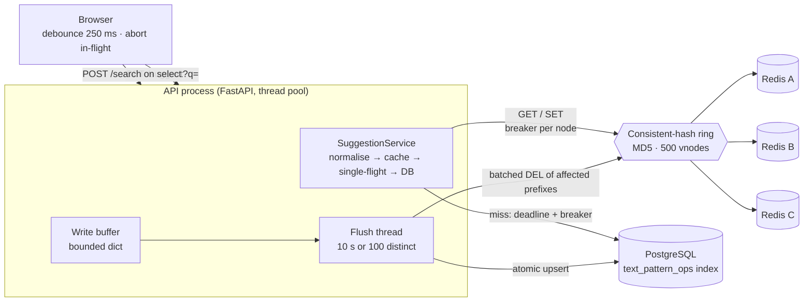

# TypeAheadX

A search-autocomplete service built as a **system design study**: prefix suggestions served from a sharded Redis cache in front of PostgreSQL, popularity updates absorbed by a write buffer, trending queries ranked with exponential decay — and, unusually for a project like this, **every claim below was measured, and the failure modes were deliberately broken and fixed.**


| | |
|---|---|
| **Stack** | FastAPI · PostgreSQL 15 · Redis 7 (3-node consistent-hash ring) · Next.js |
| **Data** | 150 000 real queries with popularity counts (AmazonQAC-derived) |
| **Hit path** | p50 **1.2 ms** @ 300 rps, p99 2 ms (one worker, one laptop, warm cache) |
| **Failure behaviour** | one Redis node lost → **0 % errors**; Postgres frozen → cache hits keep working, misses fail in ≤ 2 s |
| **Evidence** | [`audit/`](./audit/FINAL_REPORT.md) — 31 findings, interleaved A/B benchmarks, 136 tests, CI |

## 1. The problem

Autocomplete is the canonical *read-heavy, latency-critical, skewed* workload. Typing "macbook" sends 7 requests, so reads are multiplied by the typing cascade; a handful of short prefixes dominate traffic (Zipf); and the data changes (users select suggestions, queries trend) while the latency budget stays in the tens of milliseconds.

**Requirements I designed against** (self-imposed — there is no production traffic):

| Functional | Non-functional |
|---|---|
| prefix → top-10 suggestions, deterministic order | p99 well under 50 ms end-to-end on cache hits |
| selections feed back into popularity (and trending) | survive loss of a cache node and a database stall without cascading |
| unicode-safe, case/whitespace-insensitive matching | a write spike must not exhaust the database |
| | stale data bounded (≤ TTL), never silently wrong |

## 2. Architecture



* **Read path:** normalise → `GET suggestion:<prefix>` on the node that owns the key → on a miss, *one* coalesced PostgreSQL query (`LIKE 'prefix%'`, index range scan) → `SET` with a 300 s TTL. Empty results are cached too.
* **Write path:** `POST /search` is an in-memory increment (microseconds, returns immediately). A background thread flushes every 10 s or 100 distinct queries as **one atomic SQL statement**, then invalidates every cached prefix of the flushed queries.
* **Ranking:** `score = historical_count + β·recent_count·e^(−λ·hours)` with the decay evaluated at read time, so a viral query rises quickly and fades without a cron job.

Details: [`docs/ARCHITECTURE.md`](./docs/ARCHITECTURE.md) · decisions: [`docs/adrs/`](./docs/adrs) · cache: [`docs/cache-design.md`](./docs/cache-design.md) · ring: [`docs/consistent-hashing-design.md`](./docs/consistent-hashing-design.md) · writes: [`docs/write-path-design.md`](./docs/write-path-design.md).

## 3. Key design decisions and trade-offs

| Decision | Why | Cost / alternative considered |
|---|---|---|
| **PostgreSQL + `text_pattern_ops` instead of a trie/Elasticsearch** ([ADR-001](./docs/adrs/001-storage-engine.md)) | durable, transactional, a prefix is an index range scan (0.04–3.6 ms for 150 k rows) | top-N sort over all matches makes 1-char prefixes the most expensive query (3.6 ms) — exactly the ones the cache absorbs |
| **Cache-aside, JSON document per prefix** | simple, failure-tolerant (a cache miss is just slower), response served without re-parsing | staleness bounded by TTL; an invalidation race can serve a ≤ 300 s old entry |
| **Consistent hashing, 500 virtual nodes** ([doc](./docs/consistent-hashing-design.md)) | adding a node moves ≈ 26 % of keys (modulo: 75 %); ownership within ±1.8 points of 33.3 % | distributes *keys*, not *traffic*: a hot prefix still lands on one node |
| **Write buffer + batch upsert** ([ADR-006](./docs/adrs/006-write-path-durability-and-db-deadlines.md)) | a spike of selections becomes one statement every 10 s | events live in memory: a crash loses ≤ ~10 s of counter increments (explicitly accepted; popularity counters, not money) |
| **Circuit breaker per Redis node, retries off** ([ADR-004](./docs/adrs/004-cache-failure-handling.md)) | a dead node costs one 250 ms call, then zero I/O | cached entries of a dead node are simply misses until it returns |
| **Deadline + bulkhead + breaker around DB reads, none around writes** ([ADR-006](./docs/adrs/006-write-path-durability-and-db-deadlines.md)) | a hung database must not hold the 40 request threads | a timed-out write may still execute later, so writes block instead of retrying (at-most-once) |
| **Read-time decayed trending score** ([ADR-005](./docs/adrs/005-read-time-trending-ranking.md)) | stored `recent_count` of an idle query never decays by itself | not indexable — fine, the prefix index narrows rows first (+0.8 ms worst case) |
| **Single-flight per process** | 200 simultaneous misses cost 1 DB query instead of 3.5–10 | not shared across workers (≤ N queries per key with N workers) |

## 4. What the numbers say

Method matters more than the numbers: **open-loop load generator** (latency measured from the *intended* send time, avoiding coordinated omission), seeded dataset-derived workloads, **interleaved baseline-vs-final runs** (the machine drifts by 2× over hours), 3 repetitions, bootstrap CIs. Full methodology and caveats: [`docs/benchmarks.md`](./docs/benchmarks.md) and [`audit/BENCHMARK_RESULTS.md`](./audit/BENCHMARK_RESULTS.md).

Original code vs. current, one uvicorn worker, one 16-thread Windows laptop with Redis/PostgreSQL in Docker:

| Scenario | Original | Current |
|---|---|---|
| Cache-hit latency p50 @ 300 rps | 1.87 ms | **1.16 ms** |
| API CPU @ 500 rps | 74 % | **36 %** |
| Clean throughput before collapse | ≈ 600–650 rps | **≈ 700–800 rps** |
| 5× traffic burst | p50 710 ms, 1.5 % errors | **2.2 ms, 0 errors** |
| One Redis node stopped / frozen (100 rps) | 36–38 % errors, ~17 s unavailable | **0 % errors** |
| PostgreSQL frozen 20 s | 14 s with zero successes, 6 s requests | **0 s**, requests fail in ≤ 2 s, cache hits unaffected |
| 200 simultaneous identical misses | 3.5–10 DB queries | **1** |
| Flush of 100 queries | ≈ 500 ms | **≈ 14 ms** |
| 6 concurrent flushers | 67–70 % of updates lost | **0 %** |

Honest limits: single machine, single worker, loopback + Docker Desktop, synthetic typing behaviour (real query strings and popularity, invented keystroke traffic). Multi-worker scaling, Linux, million-row datasets and soak tests are **not measured** ([`audit/CAPACITY_AND_LIMITS.md`](./audit/CAPACITY_AND_LIMITS.md)).

## 5. Failure behaviour

| Failure | What happens | Evidence |
|---|---|---|
| Redis node stops / hangs | its breaker opens after one failed call; its keys are misses (→ PostgreSQL); other nodes unaffected | outage runs: 0 errors, p99 9 ms |
| Redis node down at start-up | retried automatically when it returns | `exp_node_down_startup` |
| PostgreSQL stops answering | reads: 2 s deadline → HTTP 503 + `Retry-After`, breaker opens; cached prefixes keep being served; writes block, buffer is bounded, events persist after recovery | freeze runs, `exp_write_freeze` |
| Write flush fails | transient: events re-queued (no loss, no double count); one bad row: isolated and dropped, rest persisted | unit + integration tests |
| Traffic burst / flood of unique queries | buffer capped at 50 000 distinct queries → 503 + `Retry-After` (explicit backpressure) | `exp_write_freeze` |
| API process killed | up to one flush window (~10 s) of counter increments is lost | by design (ADR-006) |

## 6. Running it

```bash
docker compose up -d                                   # PostgreSQL :5433, Redis :6379-6381 (loopback only)
cd backend && python -m venv .venv && .venv/Scripts/pip install -r requirements.txt   # bin/ on Linux/macOS
cp .env.example .env && python ingest.py               # 150 000 queries
uvicorn app.main:app --port 8000
cd ../frontend && npm ci && npm run dev                # http://localhost:3000
```

Tests (71 need nothing; 65 run against real PostgreSQL + Redis, opt-in via two env vars — see [`backend/tests/conftest.py`](./backend/tests/conftest.py)):
`cd backend && pip install -r requirements-dev.txt && pytest`. CI runs everything on every PR.
Benchmarks: [`benchmarks/README.md`](./benchmarks/README.md) — disposable stack, one command per scenario, interleaved A/B runner.

Useful endpoints: `GET /suggest?q=` · `POST /search {"query": ...}` · `GET /ready` · `GET /metrics` · `GET /cache/debug?prefix=` (ring routing; disable with `ENABLE_DEBUG_ENDPOINTS=false`).

## 7. Repository map

```
backend/app/        api · services (normalisation, suggestion service) · cache (ring, Redis nodes) · write_buffer · database (guard) · repositories
backend/tests/      136 tests: unit, real-PostgreSQL/Redis integration, property-based, fault injection
benchmarks/         open-loop load generator, scenarios, A/B runner, fault-injection experiments, mutation check, simulations/
docs/               architecture, per-component designs, ADRs, benchmark summary, lessons learned, archived original report
audit/              the independent audit: findings register, benchmark results + raw data, capacity, optimisation log
frontend/           Next.js UI (debounce, request cancellation, keyboard navigation)
data/               the 150 000-row query corpus and how it was derived
```

## 8. What I would do next

1. Authentication / rate limiting on `POST /search` (anyone can currently inject suggestions).
2. Tune β/λ on real traffic and A/B the trending term.
3. Re-measure on Linux with 2–4 workers and a separate load generator; add a million-row dataset and a 24 h soak.
4. Give writes an idempotency key so they can carry a deadline safely; tear down hung connections.
5. If counter durability ever matters: a local journal / Redis stream *before* the in-memory buffer.

## 9. Lessons

The short version (full list with evidence in [`docs/lessons-learned.md`](./docs/lessons-learned.md)): the headline features (cache invalidation, node-failure tolerance, horizontal write scaling, trending ranking) all *looked* implemented and were not — until each was tested by breaking it. Library defaults (redis-py's 3× retry) turned a 250 ms timeout into 5–8 s. Closed-loop benchmarks and unreplicated runs would have hidden all of it.

> `docs/archive/Project_Report.md` is the original (pre-audit) project report; several of its figures are superseded — see [`audit/FINAL_REPORT.md`](./audit/FINAL_REPORT.md) §6.
