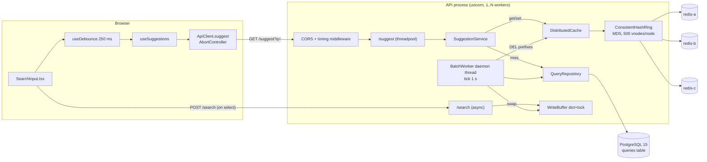
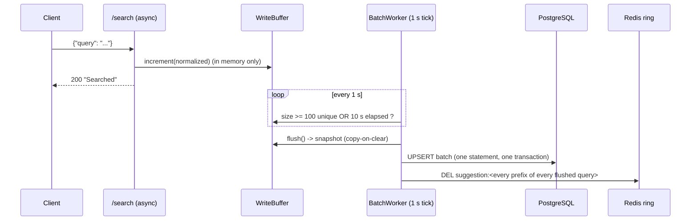

# TypeAheadX — Verified Architecture

Everything in this file was derived by reading the source at commit `a45f129` (baseline) and, where it
differs, the audited working tree. Items marked **[measured]** are backed by experiments in
`audit/results/`; **[static]** means read from code only; **[claim ≠ code]** marks places where the
repository's own documentation does not match the implementation.

## 1. Repository inventory

| Area | Files | Notes |
|---|---|---|
| API | `backend/app/main.py`, `api/{suggestions,search,cache}.py` | FastAPI; sync `def` endpoints for `/suggest` (thread pool), `async def` for `/search` |
| Service / ranking | `services/suggestion_service.py`, `services/trending_calculator.py`, `services/normalization.py` (new) | cache-aside read path |
| Persistence | `repositories/query_repository.py`, `database/{config,session}.py`, `schema.sql` | SQLAlchemy 2 (sync engine) + psycopg 3 |
| Cache | `cache/{base,factory,memory_cache,redis_cache,redis_node,distributed_cache,consistent_hash_ring,metrics}.py` | providers: memory / single redis / 3-node ring |
| Write path | `write_buffer/{buffer,batch_worker,metrics}.py` | in-process dict + daemon thread |
| Frontend | `frontend/src/**` | Next.js 16 preview, React 19, no tests |
| Data / ops | `backend/ingest.py`, `migrate.py`, `data/processed/queries.csv` (150 000 rows), `docker-compose.yml` | no app Dockerfile, no CI |
| Experiments (pre-audit) | `scripts/*.py` | simulations + a closed-loop benchmark; see `FINAL_REPORT.md` §Claims |
| Tests (pre-audit) | `backend/tests/test_suggest_api.py` (5 tests) | needs live DB+Redis; see §7 |

## 2. Component diagram

## 3. Read lifecycle (`GET /suggest?q=…`) **[static + measured]**

1. Keystroke → `useDebounce` (250 ms) → `useSuggestions` effect → `ApiClient.suggest` aborts the previous in-flight request (shared static `AbortController`), `isMounted` guards late results. Out-of-order rendering is therefore prevented by abort + effect cleanup.
2. HTTP → CORS middleware → `BaseHTTPMiddleware` timing header → router. `suggest` is a *sync* function, so Starlette runs it in the AnyIO thread pool (default 40 threads).
3. `Depends(get_settings)` — **baseline builds `Settings()` (re-parses `.env`) on every request**; `get_service` builds a repository + service per request.
4. `validate_and_normalize`: NFC → `strip().lower().split()` joined by single spaces; empty → 400; > `MAX_PREFIX_LENGTH` (64) → 400.
5. `cache.get("suggestion:<prefix>")` → MD5 → `bisect` → one of three `RedisNode`s → `GET` (JSON). Any error → treated as a miss (recorded in `CacheMetrics.errors`).
6. Miss → `SELECT query, historical_count FROM queries WHERE query LIKE <prefix>% ORDER BY historical_count DESC, query ASC LIMIT 10` (sync SQLAlchemy session; pool 5+10 default) → `SETEX key 300 json`.
7. Response: pydantic `SuggestionResponse` (validated twice: constructed, then re-validated by `response_model`) → JSON.
8. `total_results` is `len(suggestions)` (≤ 10), **not** the number of matches **[static]**.

### Ranking **[claim ≠ code]**
`docs/ARCHITECTURE.md` §4 states `final_score = historical_count + 10·recent_count`. The SQL orders by `historical_count DESC, query ASC` only. `recent_count`, `last_decay_at` and `TRENDING_BETA` never influence a read. `idx_trending_score` (expression index on the documented formula) is **never used by any query** (`pg_stat_user_indexes.idx_scan = 0`, 3.2 MB) **[measured]** but is maintained on every upsert.

## 4. Write lifecycle (`POST /search` → visible suggestion) **[static + measured]**

* Flush triggers are **100 distinct queries** (not 100 events) or **10 s**, evaluated on a 1 s tick **[static]**.
* **Durability:** buffered events exist only in process memory. A crash/`SIGKILL`/OOM loses up to ~10–11 s of events **[static]**. Graceful shutdown flushes (`on_shutdown → batch_worker.stop()`).
* Baseline defects: invalidation used key `suggest:
` while reads use `suggestion:
` (never matched) **[measured]**; read-modify-write flush loses updates across processes; a single bad row or any DB error discards the whole snapshot **[measured]** (see `FINDINGS.md`).
* Consistency model: eventual. A reader can still repopulate a cache entry from a pre-commit read after invalidation (classic cache-aside race); entries are bounded by `CACHE_TTL_SECONDS` (300 s). Not eliminated, documented as residual risk.

## 5. Distributed cache **[static + measured]**

* Ring: MD5 of `"<node>_replica_<i>"`, 500 virtual nodes/node, sorted list + `bisect_left`, wrap-around to index 0. Deterministic across processes (does not use Python `hash()`), verified by `tests/test_hash_ring.py` (subprocess with different `PYTHONHASHSEED`).
* **There is no node health tracking and no ring removal.** The design doc's claim that a dead node's vnodes are "instantly deleted from the ring" **[claim ≠ code]**. Keys of a dead node are simply misses (after waiting for the socket timeout in the baseline).
* Node naming: `redis-a/b/c` only for `localhost:6379-6381`; any other host/port is named `host:port` (changes the hash positions!). Renaming a node = remapping its keys.
* No cross-process coordination exists; consistency across API instances relies purely on identical `REDIS_NODES` / `VIRTUAL_NODES`.

## 6. External services and operational assumptions

| Service | Assumption in code | Verified? |
|---|---|---|
| PostgreSQL 15 | reachable at `DATABASE_URL`; schema from `schema.sql`; default config | yes (docker `postgres:15-alpine`) |
| Redis ×3 | no auth, no TLS, no persistence, no `maxmemory` policy in compose | yes; keys only expire by TTL (no eviction config) |
| Single host | metrics (`CacheMetrics`, `WriteMetrics`) and the write buffer are per-process; with `--workers N` each worker has its own buffer and counters | static |
| Clock | baseline decay uses the app clock; the audited version uses the DB clock | static |

## 7. What the pre-audit tests actually proved

`backend/tests/test_suggest_api.py` — 5 tests, all via `TestClient(app)` (no lifespan ⇒ no batch worker, no warm-up), against whatever DB/Redis the developer's `.env` points to:
`/health` shape; `/suggest?q=iph` (assertions are vacuous on an empty result list); empty → 400; no-result prefix; case-insensitivity. **No coverage** of `/search`, the write buffer, trending math, cache behaviour, the hash ring, failure paths or concurrency. See `FINAL_REPORT.md` for the replacement suite.

## 8. Unknowns that cannot be resolved from the repository

1. Real production request distribution (no request log; dataset counts are *selection* counts from AmazonQAC, not keystroke traffic).
2. Deployment topology (number of API workers/instances, Redis placement, network RTT, TLS/auth proxies).
3. Whether `/search`, `/metrics`, `/cache/debug` are exposed publicly (no auth exists in the code).
4. Intended behaviour for trending ranking (docs say it is blended into ranking; code does not).
5. Service-level objectives (none are stated); the SLOs used in `CAPACITY_AND_LIMITS.md` are explicit assumptions.

## 9. Changes made during the audit (delta to sections 3–5)
* **Read path:** one shared normaliser (`services/normalization.py`: NFC + lower + whitespace collapse; control characters / lone surrogates / over-length rejected with 400);
  prefix matched literally (`LIKE … ESCAPE '\'`); the cached value is the complete JSON response and a hit is returned without re-validation; concurrent misses for a key are
  coalesced (single-flight, per process); `Settings` is cached; timing header via plain ASGI middleware; request bodies > 16 KiB → 413; database errors → 503.
* **Cache:** each Redis node has a circuit breaker (open 5 s after a failure, one half-open probe), 250 ms timeouts, **client retries disabled**, lazy connection (a node down at
  start-up is retried); invalidation is batched per node (`DEL` ≤ 100 keys) and uses the same key function as reads; `RedisCache` is a one-node ring sharing this code.
* **Write path:** buffer capped (`WRITE_BUFFER_MAX_UNIQUE`, 503 + `Retry-After` beyond it); flush = one `INSERT … SELECT … FROM unnest(…) ORDER BY q ON CONFLICT DO UPDATE` (atomic, decay on the
  database clock); on failure: database reachable ⇒ bisect and drop only the unpersistable row, database unreachable ⇒ re-queue the uncommitted remainder; commit is never followed by a re-queue;
  final flush on shutdown even if the loop thread died; new metrics (`flush_failures`, `events_requeued`, `events_dropped`, flush duration).
* **Operations:** `/ready` (database ping), `ENABLE_DEBUG_ENDPOINTS`, `CORS_ORIGINS`, DB pool/connect timeouts (5 s), lifespan instead of `on_event`.
* **Ranking (follow-up commit):** `historical_count + β·recent_count·exp(−λ·hours since the last update)`, decay evaluated at read time; `idx_trending_score` removed. Rows never searched via `/search` rank exactly as before.
* **Database guard (follow-up commit):** read-path DB calls run behind a deadline (2 s), a concurrency limit (12) and a circuit breaker (`app/database/guard.py`, breaker shared with the Redis nodes in `app/utils/breaker.py`); failures are HTTP 503 + `Retry-After`; cache hits are unaffected. Writes are not guarded (a timed-out write may still execute).
* **CI (follow-up commit):** `.github/workflows/ci.yml` — backend tests against PostgreSQL + 3 Redis service containers, bandit/ruff/pip-audit, frontend `npm ci` + `tsc` + build.
* **Unchanged on purpose:** response schema, endpoints, cache key format (`suggestion:<prefix>`), TTL 300 s, flush policy (10 s / 100 distinct queries).
