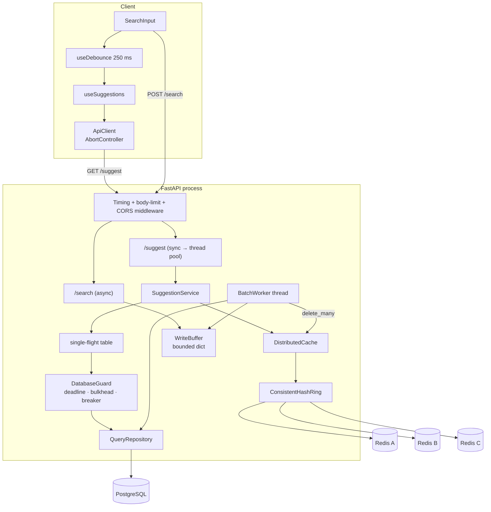
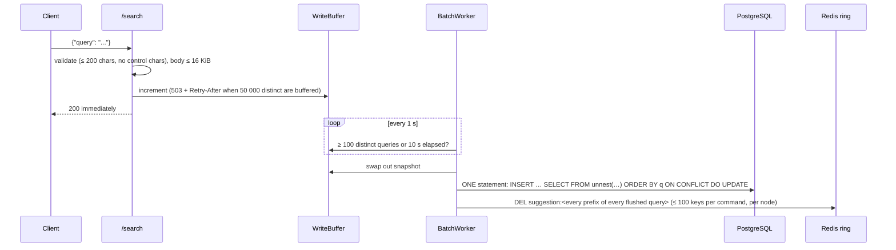

# TypeAheadX — Architecture

The definitive technical reference. It describes what the code **does** (verified by tests and benchmarks — see
[`audit/`](../audit/FINAL_REPORT.md)); design rationale lives in [`adrs/`](./adrs), measured behaviour in
[`benchmarks.md`](./benchmarks.md).

## 1. Components



| Layer | Module | Responsibility |
|---|---|---|
| API | `api/suggestions.py`, `api/search.py`, `api/cache.py`, `main.py` | validation, HTTP mapping (400 / 413 / 503), `/ready`, `/metrics`, lifespan (start-up warm-up, final flush on shutdown) |
| Service | `services/suggestion_service.py`, `services/normalization.py` | one normaliser for reads, writes, cache keys and invalidation; cache-aside; single-flight |
| Cache | `cache/distributed_cache.py`, `redis_node.py`, `consistent_hash_ring.py` | routing, per-node breaker, short timeouts, no client retries, batched deletes |
| Persistence | `repositories/query_repository.py`, `database/{session,guard,config}.py` | prefix query + ranking SQL, atomic upsert, deadline/bulkhead/breaker on reads |
| Write path | `write_buffer/{buffer,batch_worker,metrics}.py` | aggregation, flush policy, failure handling, invalidation |

## 2. Data model

```sql
queries(id BIGSERIAL PK, query TEXT UNIQUE NOT NULL, historical_count BIGINT, recent_count DOUBLE PRECISION,
        last_decay_at TIMESTAMPTZ, last_searched_at TIMESTAMPTZ, created_at TIMESTAMPTZ)
INDEX idx_query_prefix ON queries (query text_pattern_ops)     -- LIKE 'prefix%' becomes a range scan
```
`text_pattern_ops` is required because the database collation (`en_US.utf8`) is not byte-ordered, so the default btree
cannot serve `LIKE`. The unique constraint carries its own btree (used by `ON CONFLICT`). Only these three indexes
exist; the earlier expression index on the trending score had zero scans and cannot serve a read-time-decayed score
([ADR-005](./adrs/005-read-time-trending-ranking.md)).

## 3. Read path (`GET /suggest?q=`)

1. **Validate/normalise** (`normalization.validate_text`): NFC → lower-case → trim/collapse whitespace; empty → 400; > 64 chars → 400; control characters or lone surrogates → 400.
2. **Cache lookup:** key `suggestion:<normalised prefix>` → ring → owning Redis node → value is the *complete JSON response*; a hit is returned as-is (no re-validation).
3. **Miss:** `_single_flight` — the first request for a key becomes the *leader*; concurrent identical requests wait (≤ 5 s) for its result. The leader calls PostgreSQL through the guard, stores the document (`SET … EX 300`) and wakes the followers.
4. **Query:** `WHERE query LIKE :escaped_prefix% ESCAPE '\' ORDER BY score DESC, historical_count DESC, query ASC LIMIT 10` where `score = historical_count + β·recent_count·e^(−λ·Δt)`. `%`, `_`, `\` typed by users are escaped, so they match literally.
5. **Failure mapping:** database timeout / saturation / open breaker → `503 + Retry-After: 2`; other database errors → `503 + Retry-After: 1`; a Redis problem is *never* an error — it is a miss.

`total_results` is the number of returned rows (≤ 10), not the number of matches.

## 4. Write path (`POST /search`)



* **Atomicity & concurrency:** the merge happens in SQL under row locks (`historical_count = queries.historical_count + EXCLUDED…`, decay computed on the database clock), rows ordered consistently → concurrent flushers (several workers/instances) neither lose updates nor deadlock.
* **Failure handling:** database reachable but the batch fails → bisect to isolate the unpersistable row, drop only it (`events_dropped`). Database unreachable → the uncommitted remainder is re-queued (bounded). A successful commit is never followed by a re-queue (no double counting). Graceful shutdown flushes once more.
* **Durability:** the buffer is process memory. `kill -9` loses ≤ one flush window (~10 s). The flush path is intentionally **not** deadline-guarded: a timed-out write may still execute later, so retrying it would double count ([ADR-006](./adrs/006-write-path-durability-and-db-deadlines.md)).

## 5. Ranking

`score = historical_count + β·recent_count·e^(−λ·hours)` (β = 10, λ = 0.5 per hour by default). `recent_count` is rewritten only when a query is flushed (decayed to that moment, plus the new searches); the *read* applies the remaining decay. Queries never searched through `/search` have `recent_count = 0` and rank exactly by `historical_count`. Cached results keep their order for ≤ 300 s.

## 6. Cache and consistency

* **Routing:** MD5 of the key on a ring with 500 virtual nodes per physical node; deterministic across processes (does not use Python's randomised `hash()`); adding a node moves ≈ 26 % of keys. There is **no** automatic ring membership change: a failed node is *skipped* by its breaker, not removed from the ring.
* **Per-node breaker:** opens for 5 s (+0–20 % jitter) after a failure; a single probe tests recovery; timeouts 250 ms; redis-py's default 3× retry is disabled (it turned a 250 ms timeout into 5–8 s).
* **Consistency model:** eventual. After a flush, affected prefixes are deleted, so the next read recomputes. A reader that fetched from PostgreSQL *before* the commit can re-populate a key after the delete; that entry lives ≤ TTL (300 s). Accepted and bounded.
* **Negative caching:** empty results are cached (same TTL).
* **Memory:** ≈ 540–700 bytes per cached prefix; Redis runs with `noeviction` in the compose file — set `maxmemory` + `allkeys-lru` in production.

## 7. Failure modes (measured)

| Failure | Behaviour | Mechanism |
|---|---|---|
| 1 of 3 Redis nodes stopped/frozen | 0 errors, p99 ≈ 9 ms at 100 rps | breaker + 250 ms timeout + no retries |
| Redis unreachable at start | lazily retried | lazy client + breaker |
| PostgreSQL frozen | misses → 503 in ≤ 2 s; hits unaffected; recovery within the breaker window | `DatabaseGuard` |
| PostgreSQL down / connection refused | misses → 503, breaker avoids hammering connects (5 s connect timeout) | guard + pool/connect timeouts |
| Flush fails | no event lost (re-queued) or one row dropped (isolated) | `BatchWorker._write` |
| Unique-query flood on `/search` | bounded memory, 503 backpressure | buffer cap |
| Process crash | ≤ ~10 s of increments lost | design trade-off |

## 8. Scaling notes (reasoned, **not** measured)

* `--workers N` / multiple pods: ranking writes stay correct (atomic SQL); the write buffer, single-flight table, metrics and breakers are **per process**, so coalescing is ≤ N queries per key and `/metrics` shows one worker.
* Adding Redis nodes: ≈ 26 % of keys move (cold misses, no failure); a hot prefix still lives on one node — a local LRU or key replication would be the next step, but no measurement shows it is needed.
* A bigger corpus: the cost driver is the top-N sort over all matches of a short prefix (3.6 ms at 6 177 matches). Options: precomputed top-K per short prefix, or a trie/search engine ([ADR-001](./adrs/001-storage-engine.md) records why they were not chosen).

## 9. Non-goals
Fuzzy/typo-tolerant matching, personalisation, multi-language ranking, authentication, multi-region replication.
